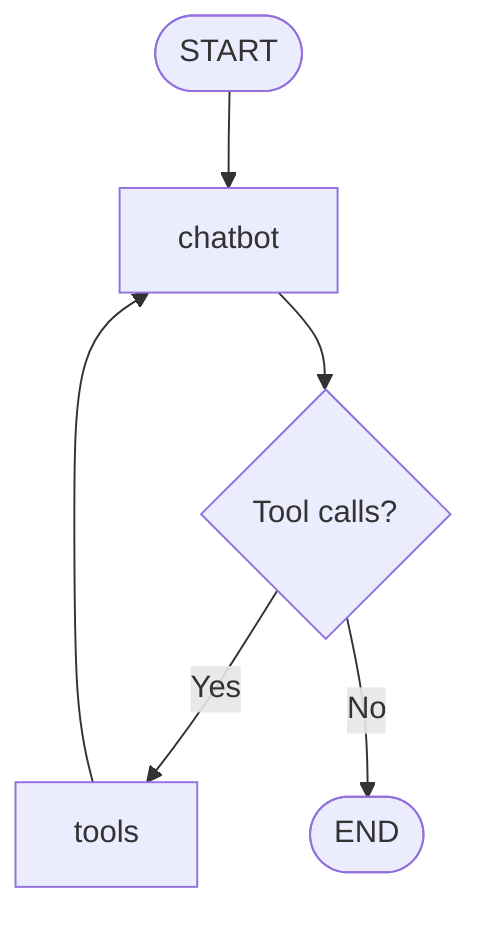

# LangGraph Tool-Calling Agent

A simple tool-calling AI agent built with Python, LangChain, LangGraph, and OpenAI's GPT-4o-mini.

The project demonstrates how to build an agent workflow from scratch using LangGraph's `StateGraph` API, with manually defined nodes, edges, conditional routing, and state management.

Instead of relying on a prebuilt agent abstraction, the workflow explicitly controls how the LLM interacts with tools and processes their results.

## Features

- **LLM integration** — Uses OpenAI's GPT-4o-mini to interpret user requests and decide when to call a tool.
- **Custom tool** — Implements a palindrome checker using a Python function decorated with LangChain's `@tool`.
- **Manual graph construction** — Defines the workflow using `StateGraph`, nodes, edges, and conditional routing.
- **Tool execution** — Uses LangGraph's `ToolNode` to execute tool calls requested by the LLM.
- **Message state management** — Uses `TypedDict`, `Annotated`, and `add_messages` to manage conversation messages during graph execution.
- **Iterative execution** — Routes tool results back to the LLM so it can generate a final response.

## Architecture

The workflow consists of two nodes:

- `chatbot` — Invokes the LLM with the current message history and available tools.
- `tools` — Executes tool calls through `ToolNode`.



### Execution Flow

1. The user submits a message to the graph.
2. The `chatbot` node invokes the LLM.
3. The LLM either generates a response or requests a tool call.
4. Conditional routing checks whether the latest AI message contains tool calls.
5. If a tool call exists, execution moves to the `tools` node.
6. The tool result is added to the message state, and control returns to the `chatbot` node.
7. The LLM processes the tool result and generates a final response.
8. The graph terminates when no additional tool calls are requested.

## Tech Stack

- Python
- LangGraph
- LangChain
- OpenAI API (`gpt-4o-mini`)
- Python-dotenv

## Key Concepts

- Building agent workflows with `StateGraph`.
- Defining graph state with `TypedDict` and `Annotated`.
- Managing messages with the `add_messages` reducer.
- Binding tools to an LLM using `bind_tools()`.
- Executing tools with `ToolNode`.
- Implementing conditional routing with `add_conditional_edges()`.
- Creating iterative tool-calling loops using graph edges.

## Getting Started

### 1. Clone the repository

```bash
git clone <your-repository-url>
cd search_agent
```

### 2. Create a virtual environment

```bash
python3 -m venv .venv
source .venv/bin/activate
```

### 3. Install dependencies

```bash
pip install langgraph langchain langchain-openai python-dotenv
```

### 4. Configure environment variables

Create a `.env` file in the project root:

```env
OPENAI_API_KEY=your_openai_api_key
```

### 5. Run the application

```bash
python main.py
```

Replace `main.py` with the name of your Python script if necessary.

## Current Scope

This project focuses on understanding the internal workflow of a tool-calling agent through explicit graph construction.

Conversation messages are maintained in the graph state during execution. Persistent conversation memory across separate invocations is not currently configured.

## Possible Improvements

- Add more custom tools and external data sources.
- Implement conversation persistence with LangGraph checkpointing.
- Add error handling and tool input validation.
- Build an interactive CLI for multi-turn conversations.
